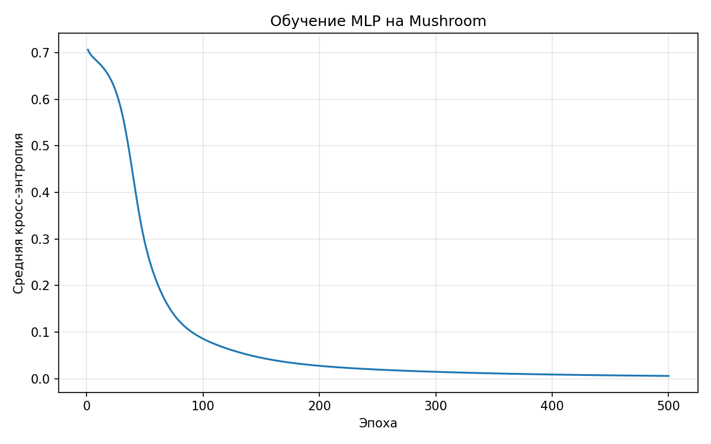
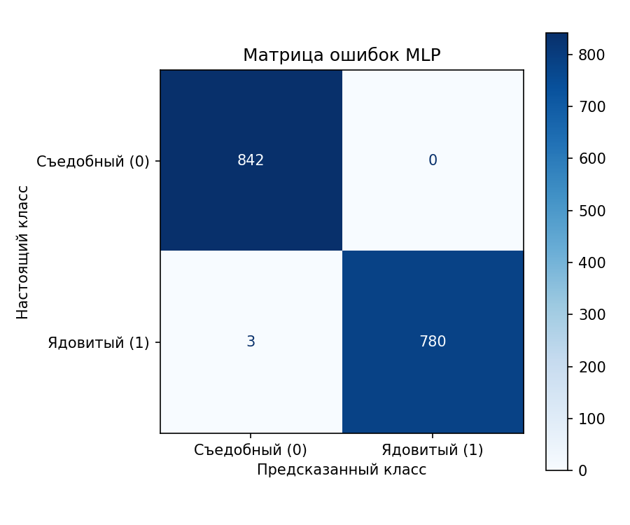
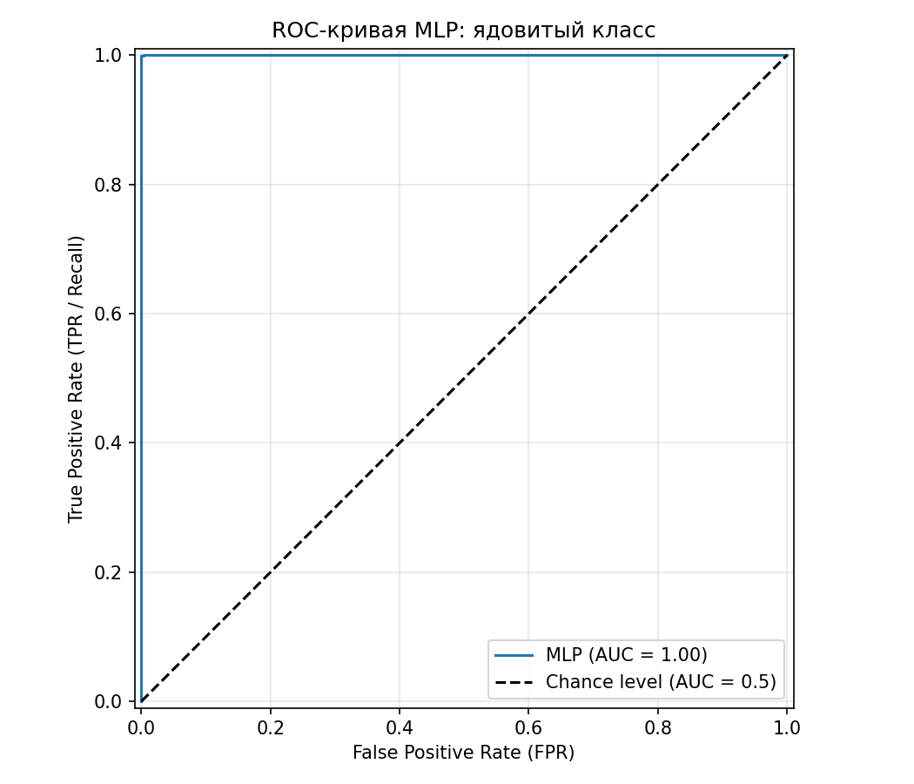

# Лабораторная № 1. Многослойный персептрон

Реализован многослойный персептрон для классификации грибов на съедобные и ядовитые по данным [Mushroom из UCI Machine Learning Repository](https://archive.ics.uci.edu/dataset/73/mushroom). На тестовой выборке модель правильно определила класс **1622 из 1625 грибов: accuracy — 99,82%**.

Категориальные признаки преобразованы с помощью one-hot кодирования, пропуски выделены в категорию `missing`. После подготовки каждый объект содержит 117 числовых признаков. Стратифицированное разбиение 80/20 дало 6499 обучающих и 1625 тестовых объектов.

Архитектура: **117 → 32 → 16 → 2**. В двух скрытых слоях используется сигмоида, на выходе — softmax. Прямой проход, кросс-энтропия, градиенты и обновление весов реализованы самостоятельно на NumPy. Обучение выполнено обычным градиентным спуском за **500 эпох с шагом 0,6**. Зерно инициализации и разбиения — **42**.

Результаты соответствуют выполненному [блокноту](source/main.ipynb) и [итоговой таблице метрик](data/mlp_metrics.csv). Положительный класс для precision, recall, F1 и ROC-AUC — **1, ядовитый гриб**.

| Метрика | Значение |
|---|---:|
| Accuracy | 0,998154 |
| Precision | 1,000000 |
| Recall | 0,996169 |
| F1-мера | 0,998081 |
| ROC-AUC | 0,999995 |
| Тестовая кросс-энтропия | 0,008205 |

## Функция потерь

Обучающая кросс-энтропия снизилась с **0,706579 до 0,005942**. На графике показано её среднее значение перед обновлением весов на каждой эпохе.

## Матрица ошибок

Из 842 съедобных грибов все классифицированы правильно. Из 783 ядовитых правильно определены 780, ещё **3 ошибочно названы съедобными**. Поэтому precision равна 1, а recall и F1 немного ниже 1.

Строки матрицы соответствуют настоящим классам, столбцы — предсказанным.

## ROC-кривая и AUC

ROC-кривая рассчитана по вероятностям ядовитого класса. **ROC-AUC = 0,999995**; в легенде графика значение округлено до 1,00. Эта метрика характеризует ранжирование вероятностей. При выборе класса по максимальной вероятности остаются три ошибки, показанные в матрице выше.

Модель достигла высокой точности на выбранном тестовом разбиении. Основная оставшаяся ошибка — пропуск трёх ядовитых грибов.

