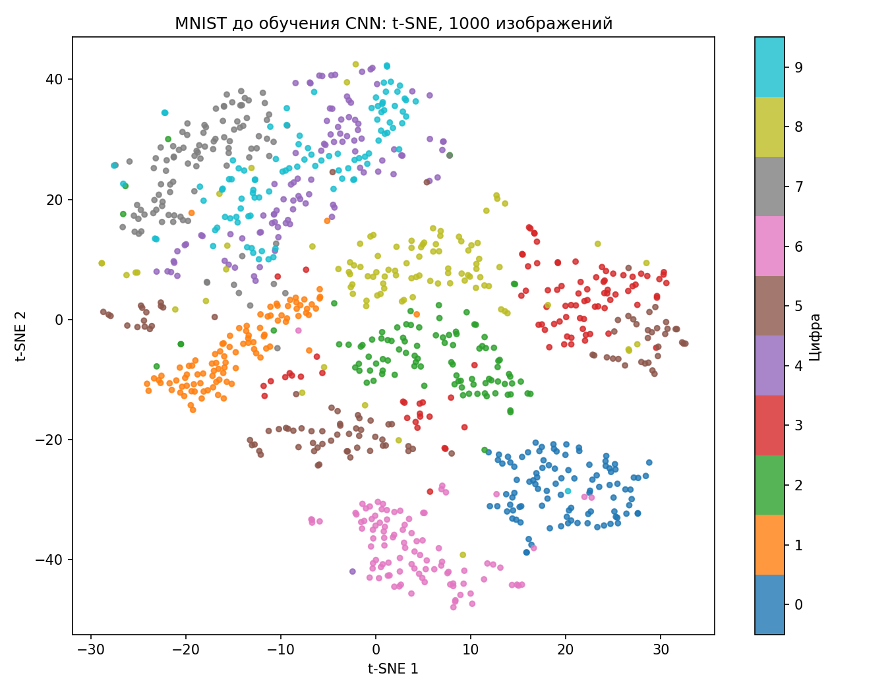
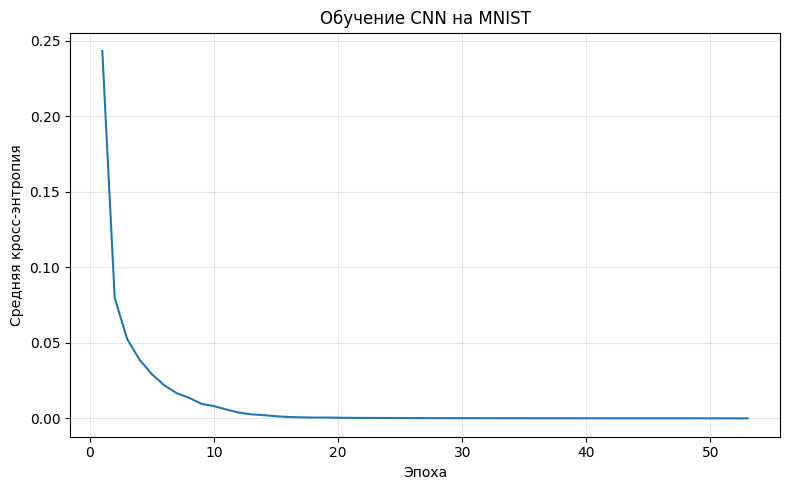
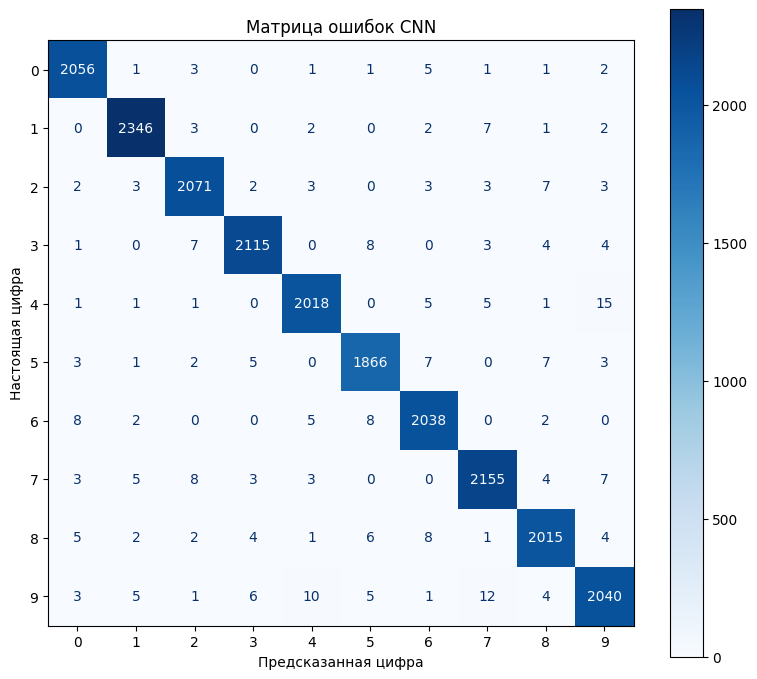
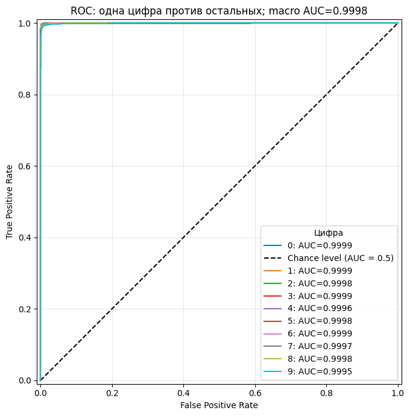
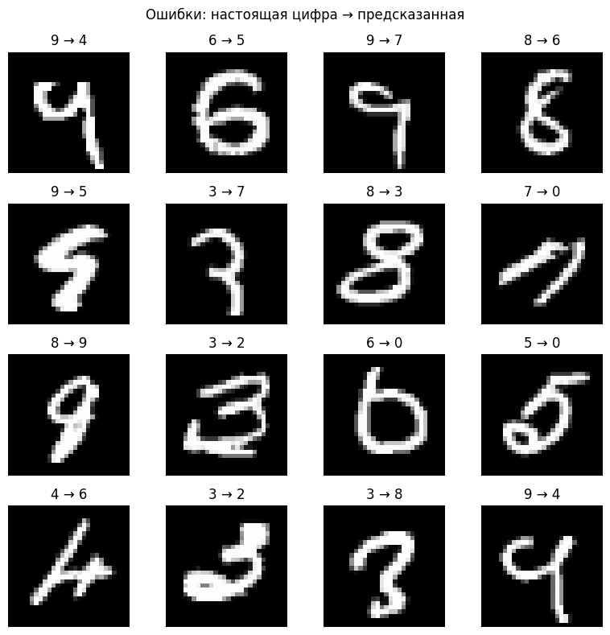

# Лабораторная № 2. Свёрточная нейронная сеть

Реализована свёрточная нейронная сеть для распознавания рукописных цифр MNIST: десять классов от 0 до 9. На тестовой выборке правильно распознаны **20 720 из 21 000 изображений: accuracy — 98,67%**.

Исходные части MNIST объединены и разделены в пропорции 70/30 с сохранением долей классов: 49 000 изображений для обучения и 21 000 для теста. Пиксели нормализованы делением на 255. Вход модели имеет форму `(N, 1, 28, 28)`.

Сеть использует свёртку с **8 фильтрами 3×3**, отступом 1, ReLU и MaxPool2d 2×2. После разворачивания 1568 признаков идут полносвязные слои на **64 и 10 нейронов** с ReLU и softmax. Прямой проход, градиенты и обновление параметров реализованы самостоятельно на NumPy.

Обучение выполнено градиентным спуском с шагом **0,2** и размером мини-батча **64**. Зерно инициализации и разбиения — **42**, перемешивания батчей — **43**. Обучение остановилось на **53-й эпохе** при лимите 60 эпох: целевой порог обучающей кросс-энтропии **0,0001 достигнут**.

Отчёт составлен по последнему выполненному прогону в [блокноте](source/main.ipynb). Для precision, recall и F1 используется macro-усреднение: среднее по десяти классам с одинаковым весом каждого класса.

| Метрика | Значение |
|---|---:|
| Accuracy | 0,986667 |
| Precision macro | 0,986580 |
| Recall macro | 0,986577 |
| F1 macro | 0,986577 |
| ROC-AUC macro OVR | 0,999791 |
| Обучающая кросс-энтропия с итоговыми весами | 0,000093 |
| Тестовая кросс-энтропия | 0,074804 |

## t-SNE до обучения CNN

В [EDA](source/eda.ipynb) построен t-SNE через scikit-learn для 1000 обучающих изображений: по 100 каждой цифры. Вход — 784 нормализованных пикселя, выход — две координаты. Параметры: `perplexity=30`, `learning_rate=200`, `max_iter=500`, `init="random"`, `random_state=42`.

Цифры 0, 1 и 6 образуют заметные отдельные группы. Точки 4 и 9 частично смешиваются, рядом располагается группа 7. Это согласуется с путаницей этих цифр в предсказаниях CNN. Проекция служит возможным объяснением сходства изображений; сама по себе она не доказывает причины ошибок модели.

## Функция потерь

Средняя обучающая кросс-энтропия за эпоху снизилась с **0,243338 до 0,000098**. После обучения она пересчитана на всей обучающей выборке с итоговыми весами: **0,000093**, что ниже заданного порога.

## Матрица ошибок

Модель допустила **280 ошибок**. Самые частые отдельные ошибки: **4 → 9 — 15 случаев**, **9 → 7 — 12**, **9 → 4 — 10**. Строки матрицы соответствуют настоящим цифрам, столбцы — предсказанным.

## ROC-кривые и AUC

Для каждой цифры ROC-кривая построена по её вероятности по схеме **«один класс против остальных» (OVR)**. Итоговый **ROC-AUC macro = 0,999791** — среднее AUC десяти классов. В заголовке графика значение округлено до 0,9998.

## Примеры ошибок и вывод

По примерам можно предположить, что часть ошибок связана с похожими контурами и нестандартным начертанием цифр.

Сеть достигла заданного порога обучающей ошибки и точности 98,67% на тесте. Предварительный t-SNE и примеры ошибок указывают на сходство начертания части цифр как возможную причину путаницы между классами.
